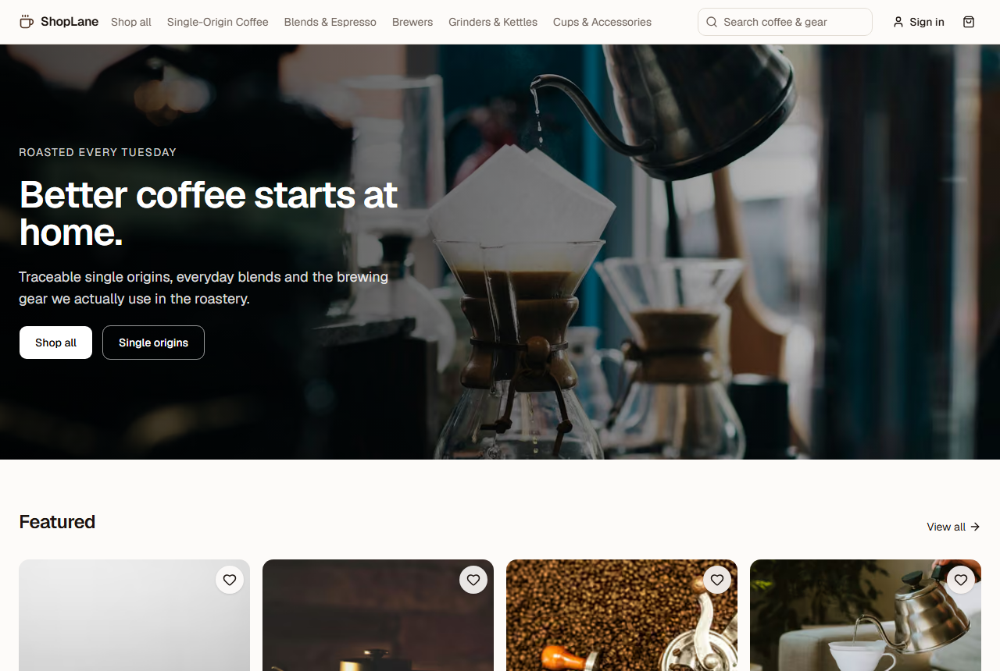
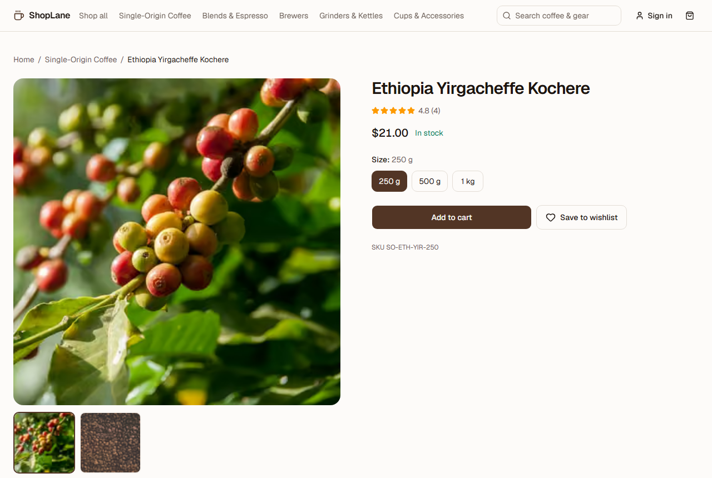
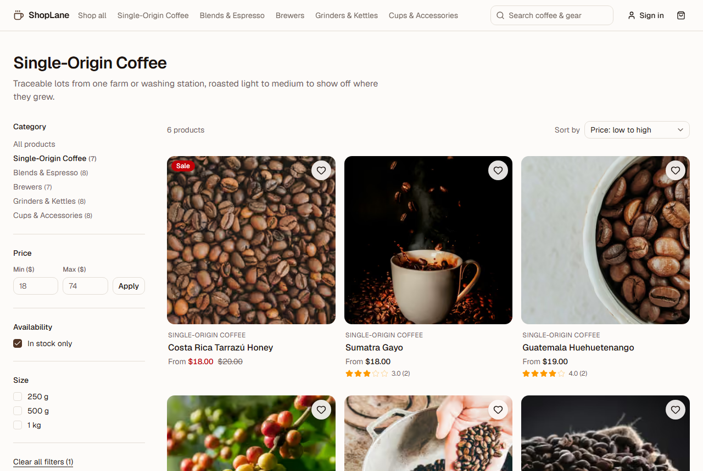
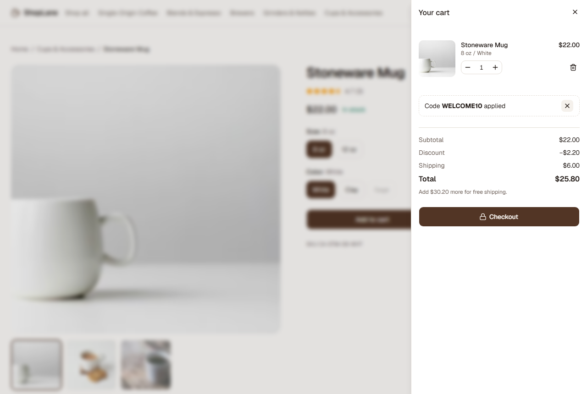
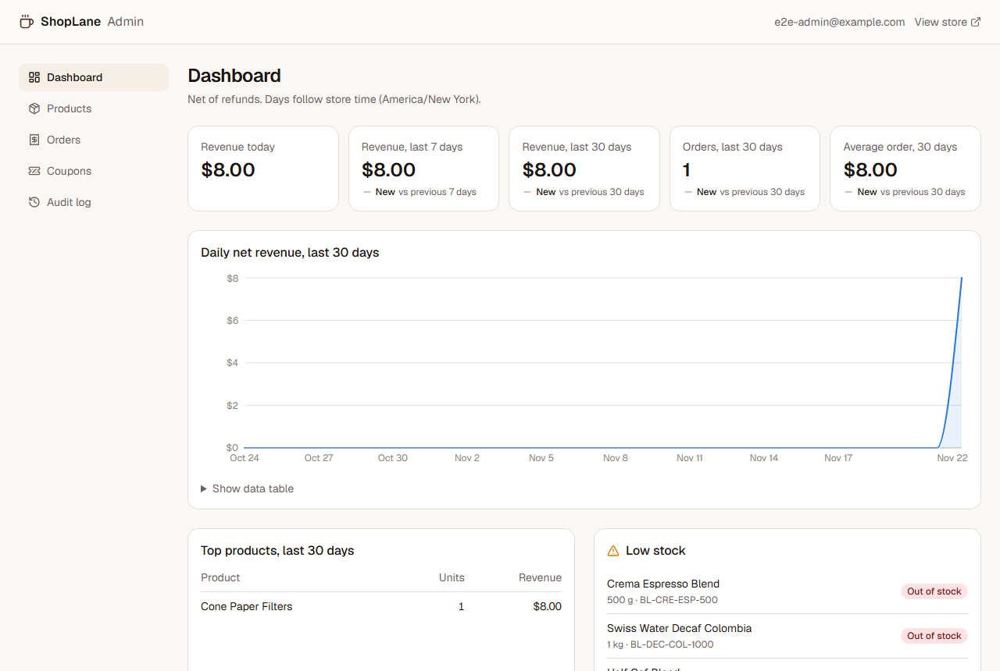
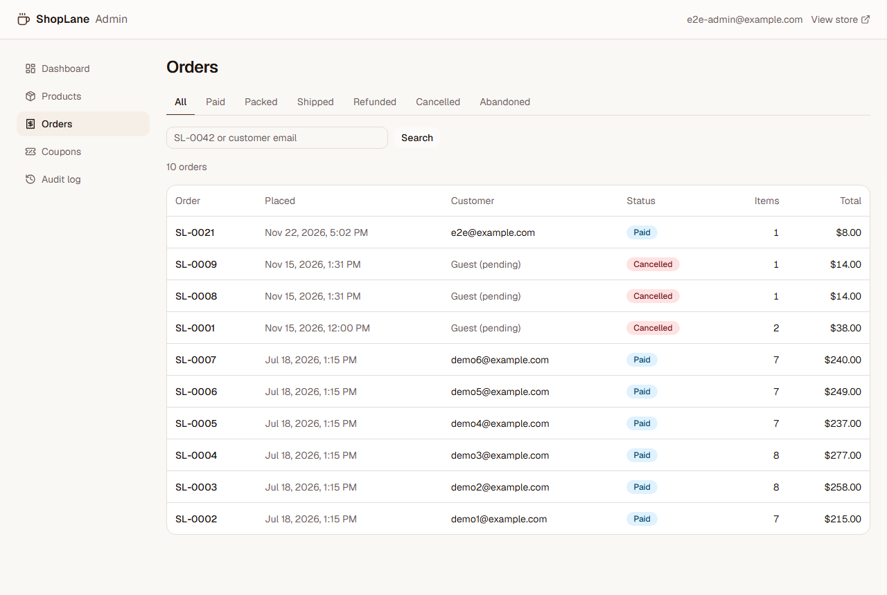
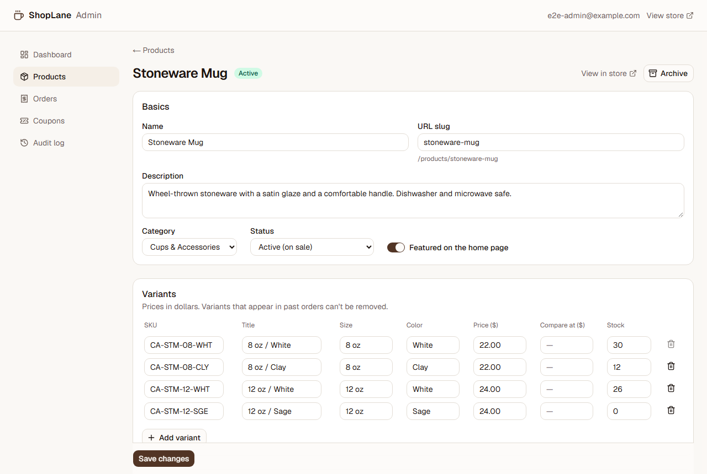
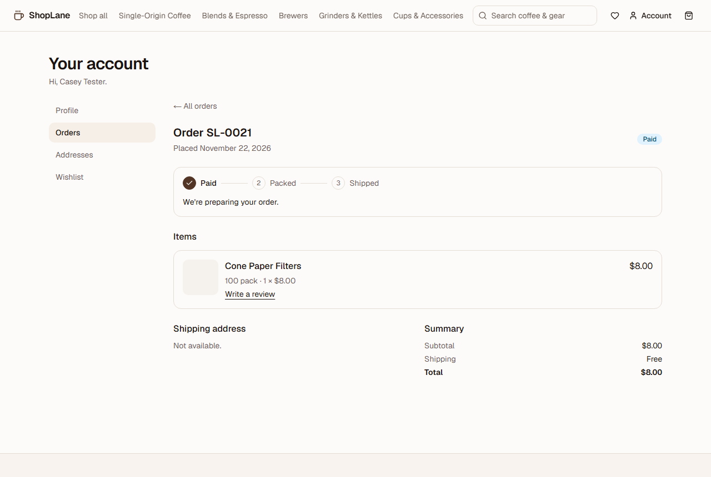
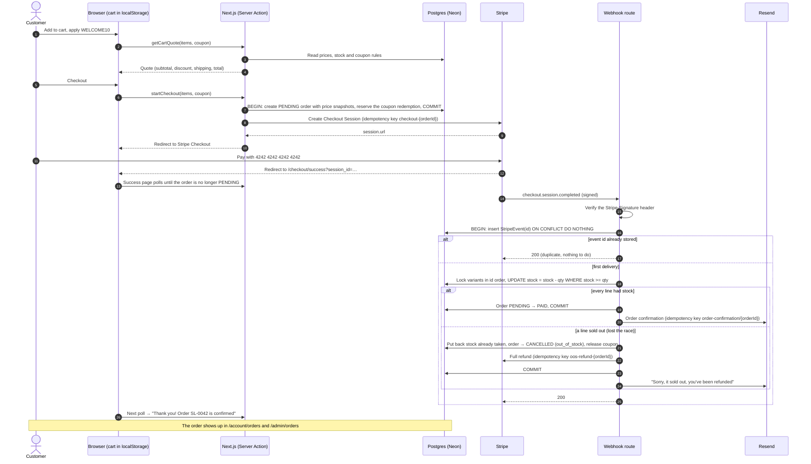

# ShopLane

An online store for a small specialty coffee roaster. It sells beans and brewing gear, takes payment with Stripe Checkout, and has an admin area for the shop team. Built with Next.js 15 (App Router, Server Components, Server Actions), Prisma 7 on Neon Postgres, Auth.js, Stripe, Tailwind 4 and shadcn/ui.

**Live demo:** _link added after the first deploy (see [docs/deploy.md](docs/deploy.md))_

### Demo login

Open **`/sign-in`** on the demo and use the **Try the demo** panel:

| Button            | Signs you in as                                                  | Lands on                                                           |
| ----------------- | ---------------------------------------------------------------- | ------------------------------------------------------------------ |
| **Demo admin**    | `demo-admin@shoplane.dev` (role `ADMIN`)                         | `/admin`: dashboard, products, orders, refunds, coupons, audit log |
| **Demo customer** | `demo1@example.com` (Jamie Rivera, with past orders and reviews) | `/account/orders`                                                  |

There's no password or email step. Payments run in **Stripe test mode**: pay with `4242 4242 4242 4242`, any future expiry and any CVC. Demo data is reset every night.

## Screenshots

| Storefront                                                   | Product                                                          |
| ------------------------------------------------------------ | ---------------------------------------------------------------- |
|                       |                     |
| **Category with filters**                                    | **Cart with a coupon**                                           |
|  |  |
| **Admin dashboard**                                          | **Admin orders**                                                 |
|      |            |
| **Admin product editor**                                     | **Customer order detail**                                        |
|   |      |

Regenerate them with `npm run screenshots`.

## Features

- **Catalog:** 5 categories and 40 products with variants (size and colour). Filters, sort and pagination live in the URL, so every view is shareable and server-rendered. Search, image galleries and verified-buyer reviews.
- **Cart:** a guest cart persisted in the browser, merged into the account on sign-in. Prices and stock are always quoted from the database. Coupons can be a percentage or a fixed amount, with a minimum spend, a date window and a usage limit.
- **Checkout:** Stripe Checkout. Orders are created as PENDING with price snapshots, and the signed **webhook** marks them paid.
- **Account:** sign-in by magic link, order history (including earlier guest orders under the same email), saved US addresses, a wishlist and reviews.
- **Admin:**
  - Revenue dashboard.
  - Product editor with variants, drag-to-reorder images (UploadThing) and SEO fields.
  - Order fulfilment with tracking emails, and full or partial Stripe refunds with optional restock.
  - Coupon management.
  - An audit log row for every change.
- **SEO:**
  - Metadata and canonical URLs on every page.
  - `Product` JSON-LD with one `Offer` per variant (price, currency, availability) plus `AggregateRating`, and `BreadcrumbList`.
  - Organization/WebSite JSON-LD with a search action.
  - `sitemap.xml` and `robots.txt` (previews are never indexed).
  - Generated Open Graph cards, built with `next/og`.

## How an order gets paid



`checkout.session.expired` cancels the PENDING order and releases its coupon. `charge.refunded` keeps `refundedCents` in sync, including refunds issued from the Stripe Dashboard.

## How the webhook is idempotent

Stripe delivers webhooks **at least once**, sometimes concurrently, and retries any non-2xx response. ShopLane makes repeat deliveries harmless in four layers:

1. **Event ledger in the same transaction.**
   - Every event starts a transaction that first inserts its id into `StripeEvent` with `createMany({ skipDuplicates: true })`, i.e. `INSERT … ON CONFLICT DO NOTHING`.
   - If the insert affects 0 rows, the event was already handled, and the route returns 200 without doing anything.
   - Because the insert shares the transaction with the order and stock writes, a handler that throws rolls the ledger row back too. Stripe's retry then runs the handler again instead of being skipped. You never get "marked as processed but nothing happened".
   - Two concurrent deliveries of the same event contend on the primary key, so only one wins.
2. **State-guarded writes.**
   - Handlers only move an order out of `PENDING`, so a late or out-of-order event finds nothing to do.
   - Stock comes off with `UPDATE … WHERE stock >= qty`, with rows locked in variant-id order so concurrent orders can't deadlock.
   - Stock is taken for every line or for none.
3. **Idempotency keys on every outbound call.**
   - Stripe: `checkout-{orderId}`, `order-coupon-{orderId}`, `oos-refund-{orderId}`, and `admin-refund-{orderId}-{requestId}`.
   - Resend: `order-confirmation/{orderId}`, `order-out-of-stock/{orderId}`, `order-shipped/{orderId}/{tracking}`.
   - A retry can't charge, refund or email twice.
4. **Side effects after commit.** Emails are sent only after the transaction commits, best-effort, so a slow email provider can't roll back a payment.

This is covered by integration tests that replay recorded Stripe fixture events: duplicates, out-of-order delivery, concurrent buyers racing for the last unit, and a handler failing mid-way. The real-payment e2e test sends a genuine test-card payment through Stripe's hosted page and the CLI-forwarded webhook.

## Lighthouse

Median of 3 runs per page, from Lighthouse CI against a production build (`npm run lighthouse`). CI fails if any score drops below 95.

| Page                                             | Device  | Performance | Accessibility | Best practices | SEO |
| ------------------------------------------------ | ------- | ----------: | ------------: | -------------: | --: |
| Home `/`                                         | Mobile  |          96 |           100 |            100 | 100 |
| Home `/`                                         | Desktop |         100 |           100 |            100 | 100 |
| Product `/products/ethiopia-yirgacheffe-kochere` | Mobile  |          96 |           100 |            100 | 100 |
| Product `/products/ethiopia-yirgacheffe-kochere` | Desktop |         100 |           100 |            100 | 100 |

Measured 2026-11-22 on a local production build (`next start`). Production numbers are added after the deploy (`npm run lighthouse -- --url https://…`). Raw numbers are in [docs/lighthouse/scores.json](docs/lighthouse/scores.json).

What keeps the scores up:

- Home and product pages are static (ISR) and purged by cache tags on admin edits.
- `next/image` serves AVIF/WebP with correct `sizes`, and only the LCP image is preloaded with `fetchpriority="high"`.
- Fonts load through `next/font`.
- Radix primitives are tree-shaken (`optimizePackageImports`).
- The cart drawer is loaded on first open.
- The session is read client-side, so pages never wait on auth.

## Accessibility

`e2e/a11y.spec.ts` runs **axe-core** (WCAG 2.0/2.1/2.2 A + AA) on the home, category, product, cart drawer, sign-in, account and admin pages, on desktop and mobile. Any serious or critical violation fails CI, and the full axe report is attached to the Playwright HTML report. Lighthouse accessibility is 100 on the audited pages.

## Tech stack

| Area          | Choice                                                                 |
| ------------- | ---------------------------------------------------------------------- |
| Framework     | Next.js 15.5 (App Router), React 19, TypeScript 5.9 (strict)           |
| UI            | Tailwind CSS 4, shadcn/ui (Radix), lucide-react, Recharts, dnd-kit     |
| State         | Zustand (cart, persisted)                                              |
| Data          | PostgreSQL 18 on Neon, Prisma 7 with the Neon serverless adapter       |
| Auth          | Auth.js v5 (database sessions, email magic link)                       |
| Payments      | Stripe Checkout + webhooks (test mode)                                 |
| Email / files | Resend + React Email, UploadThing                                      |
| Validation    | Zod 4                                                                  |
| Tests         | Vitest (unit + integration), Playwright (e2e), axe-core, Lighthouse CI |
| Hosting       | Vercel + Neon                                                          |

## Running locally

Requirements: Node 24, npm 11, a Neon project with a `dev` branch.

```bash
npm install
cp .env.example .env            # fill in DATABASE_URL, DIRECT_URL, AUTH_SECRET (Stripe optional)
npm run db:deploy               # or `npm run db:apply` if your network blocks port 5432
npm run db:seed                 # 5 categories, 40 products, coupons, demo customers and reviews
npm run dev                     # http://localhost:3000
```

- **Sign-in links:** without `RESEND_API_KEY` they're printed to the server console. Set `DEMO_MODE=true` to get the one-click demo buttons locally.
- **Admin access:** after signing in once, run `npm run admin:grant -- you@example.com`.
- **Payments:** see [docs/stripe-local-testing.md](docs/stripe-local-testing.md) for the Stripe CLI, test cards and webhook scenarios.

## Tests and checks

| Command                    | What it runs                                                                                                                    |
| -------------------------- | ------------------------------------------------------------------------------------------------------------------------------- |
| `npm run check`            | ESLint, `tsc --noEmit`, unit tests                                                                                              |
| `npm run test:integration` | Vitest against a separate Neon branch (`.env.test`): checkout, webhook, coupons, admin guards                                   |
| `npm run e2e`              | Playwright on a production build: catalog, cart, account, admin, SEO, axe, and the real Stripe purchase (needs `stripe listen`) |
| `npm run lighthouse`       | Lighthouse CI, mobile + desktop, budget ≥ 95                                                                                    |
| `npm run screenshots`      | Regenerates the README screenshots                                                                                              |

## CI/CD

[`.github/workflows/ci.yml`](.github/workflows/ci.yml) runs on every push and pull request:

1. **quality:** lint, typecheck, unit tests.
2. **e2e:**
   - Creates two throwaway Neon branches and runs `prisma migrate deploy` on both.
   - Runs the integration tests, seeds, and builds.
   - Starts `stripe listen` and runs Playwright (including the 4242 payment and axe), then Lighthouse.
   - Uploads the reports and deletes the branches.

Vercel deploys `main` to production and every pull request to a preview. Migrations run during the Vercel build. A nightly workflow resets the demo data. Setup is in [docs/deploy.md](docs/deploy.md).

## Project layout

```
src/app/            routes: (shop) storefront, admin, api (auth, Stripe webhook, uploads, demo session)
src/features/       domain logic per area: catalog, cart, checkout, account, reviews, wishlist, admin, seo, demo
src/components/     UI (shadcn/ui primitives in components/ui)
prisma/             schema, migrations, idempotent seed + demo reset
e2e/                Playwright specs (+ support/ for sessions and Stripe Checkout helpers)
scripts/            migrations over HTTPS, admin grant, Lighthouse runner
docs/               deploy guide, Stripe local testing, Lighthouse scores, screenshots
```
